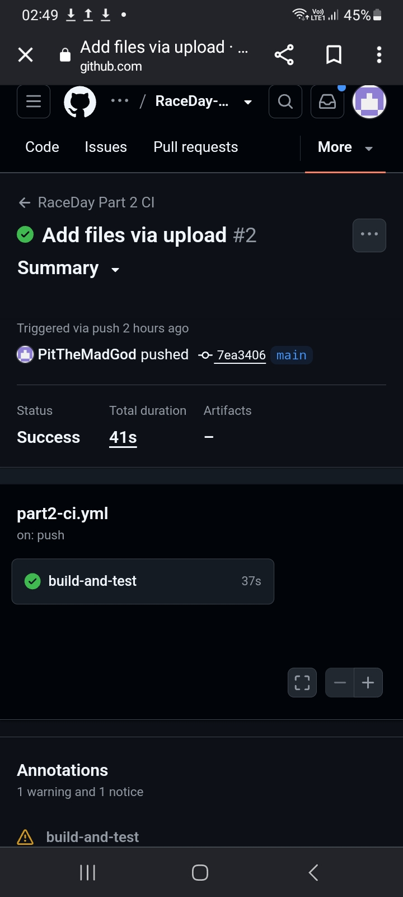

# RaceDay - Part 2: RESTful API

ASP.NET Core 8 Web API (C#) with Entity Framework Core (Code-First) and SQL Server.
Role-based cookie/session authentication for **Organiser** and **Participant** roles,
Swagger UI, xUnit tests and a GitHub Actions CI pipeline.

## Setup and run
1. Install Visual Studio 2022 (17.8+) with the ASP.NET workload (includes .NET 8 SDK) and SQL Server LocalDB.
2. Clone the repo and open `RaceDay.sln`.
3. Check the connection string in `RaceDay.Api/appsettings.json` (default is LocalDB).
4. In Package Manager Console (default project `RaceDay.Api`) run:
   ```
   Add-Migration InitialCreate
   Update-Database
   ```
5. Set `RaceDay.Api` as startup project and press F5. Swagger opens at `/swagger`.
6. Run tests: **Test > Run All Tests** or `dotnet test`.

## Roles
- **Organiser** - creates, updates and deletes events; defines categories; views all enrolments for their events; captures finish times and positions.
- **Participant** - registers/logs in; views and updates own profile; views events and categories; enrols in an event by selecting a category; views own results.

Non-public endpoints require authentication, and Organiser/Participant functionality is not accessible to the other role. Passwords are stored hashed.

## CI/CD
GitHub Actions (`.github/workflows/dotnet-ci.yml`) builds the solution and runs all unit tests on every push.



## Demo video
YouTube (unlisted): < https://youtu.be/Sjqotq00gtU?si=H6dgPAqUWkCc-26T >
