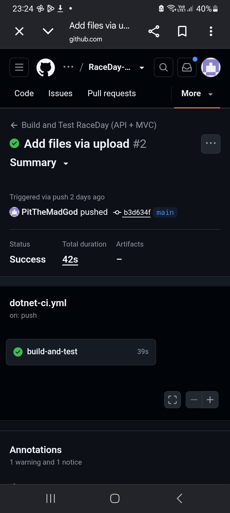

---

# Part 3: RaceDay MVC Web Application

The Part 3 code lives in the [`RaceDay_Part3`](RaceDay_Part3) folder. It contains three projects:

- **RaceDay.Api**: the Part 2 REST API (ASP.NET Core 8, EF Core Code-First, cookie authentication, Swagger), now with Azure Blob Storage for image uploads.
- **RaceDay.Mvc**: the new ASP.NET Core MVC web front end. It has no database access and no business logic of its own. Every page gets its data by calling the API.
- **RaceDay.Api.Tests**: xUnit tests for the API (authentication, events, categories, enrolments and results, success and failure cases).

## How the MVC app works with the API

- Users register and log in through the MVC app, which sends the details to `POST /api/auth/login`.
- The MVC app stores the logged-in user and role in a server-side **session** and attaches the API's auth cookie to every API call. The API still enforces the roles.
- Protected pages use `[RequireLogin]` and `[RequireRole]` filters, so unauthenticated users are redirected to the login page and users cannot open pages for the other role.
- Logging out ends the session and redirects to the login page.
- **Azure Blob Storage:** the MVC app never talks to Azure. Event banners and profile pictures are sent to `POST /api/files/upload`, the API stores them in Azure Blob Storage, and the returned image URL is saved with the event or profile.

## Roles

| Role | What they can do |
|---|---|
| **Organiser** | Dashboard (events, enrolments per event, upcoming dates); create, edit and delete events with a banner image; add, edit and delete categories; view enrolments for their events; capture, edit and delete results |
| **Participant** | Browse and filter upcoming events; view event details and categories; enrol in an event with a category; see their own enrolments with colour-coded status; see **My Results**; view and update their profile and picture |

## Running it locally

1. Open `RaceDay_Part3/RaceDay.sln` in Visual Studio 2022 (with the ASP.NET and web development workload).
2. Check the connection string in `RaceDay_Part3/RaceDay.Api/appsettings.json`. Apply the migration with `Update-Database` in the Package Manager Console (default project `RaceDay.Api`).
3. Set the Azure storage connection string. For testing, run the Azurite emulator (`"UseDevelopmentStorage=true"` is the default). For real Azure, put your storage account connection string in the API's **User Secrets** under `AzureBlobStorage:ConnectionString`. Never commit it.
4. Right-click the solution, choose **Configure Startup Projects**, select **Multiple startup projects**, and set `RaceDay.Api` and `RaceDay.Mvc` to **Start**. Press F5.
5. Make sure `ApiBaseUrl` in `RaceDay_Part3/RaceDay.Mvc/appsettings.json` matches the port the API starts on.

## Running with Docker

The MVC app runs in a Docker container (multi-stage build: .NET SDK image to build, ASP.NET runtime image to run). With the API running on port 5000, from the `RaceDay_Part3` folder:

```
docker build -t raceday-mvc -f RaceDay.Mvc/Dockerfile .
docker run -p 8080:8080 -e ApiBaseUrl=http://host.docker.internal:5000 raceday-mvc
```

Then open http://localhost:8080. The container behaves the same as the app running locally.

## Tests and CI/CD

Run the tests in Visual Studio with **Test > Run All Tests**, or on the command line with `dotnet test RaceDay_Part3/RaceDay.sln`.

The GitHub Actions workflow (`.github/workflows/dotnet-ci.yml`) restores, builds and tests the API, the MVC app and the tests on every push.



## Video walkthrough

Part 3 demo (unlisted YouTube): [https://youtu.be/FVsKyl_D4pA](https://youtu.be/FVsKyl_D4pA)
